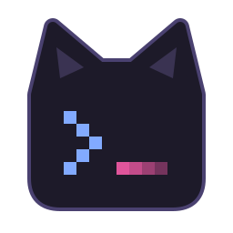
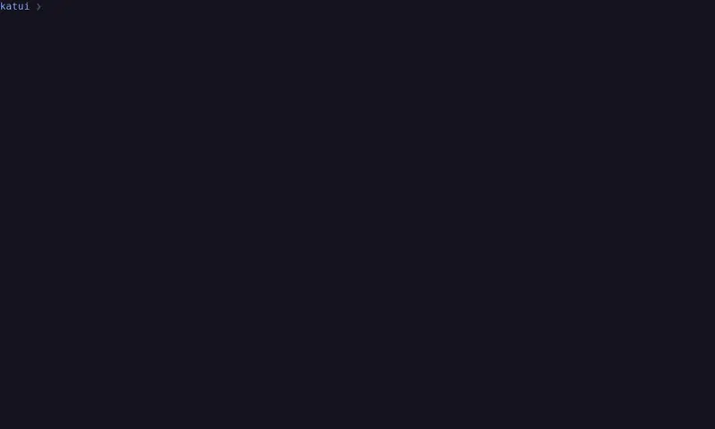

<p align="center"></p>

<h1 align="center">katui</h1>

<p align="center">
  Real pixels in your terminal, from Rust, Python and Node.js.
</p>

<p align="center">
  <a href="#install">Install</a> ·
  <a href="#a-first-program">First program</a> ·
  <a href="#what-you-can-build">What you can build</a> ·
  <a href="#terminals">Terminals</a> ·
  <a href="#demos">Demos</a> ·
  <a href="docs/README.md">Guides</a> ·
  <a href="https://h4ks-com.github.io/katui/katui/">API docs</a>
</p>

<p align="center"></p>

katui is a terminal UI library for Rust, Python and Node.js that draws real pixels. Apps, games
and video show up as images through the [kitty graphics protocol][kitty],
and terminals without it get [sixel][sixel] images or quarter-block
characters instead.

You describe what to show. katui finds out what the terminal supports, lays
out and draws your view, sends only the parts that changed, and passes keys
and mouse clicks back to you.

[kitty]: https://sw.kovidgoyal.net/kitty/graphics-protocol/
[sixel]: https://en.wikipedia.org/wiki/Sixel

## Install

katui needs Rust 1.90 or newer and runs on macOS and Linux. Start a project
and add katui with the `app` feature, which brings in the app runner and
the widgets:

```
cargo new counter && cd counter
cargo add katui --features app
```

For Python 3.14 or newer, install the package from PyPI. The
[Python guide](docs/python.md) starts from there:

```
pip install katui
```

For Node.js 22.18 or newer, install the package from npm. The
[Node.js guide](docs/node.md) starts from there:

```
npm install @mattfillipe/katui
```

For Go, add the module; the [Go guide](docs/go.md) starts there. For C,
each release has an archive with the header and the libraries, and the
[C guide](docs/c.md) shows how to link it:

```
go get github.com/h4ks-com/katui/bindings/go
```

## A first program

Put this in `src/main.rs`. It is a complete katui app: a label and a button
that counts its clicks.

```rust
use katui::app::{Control, UiApp, run};
use katui::ui::{Align, Element};
use katui::widgets::{label, panel, primary_button};

#[derive(Default)]
struct Counter(u32);

impl UiApp for Counter {
    type Message = ();

    fn view(&self) -> Element<()> {
        panel([
            label(format!("Clicked {} times", self.0)),
            primary_button("Add one", ()),
        ])
        .align(Align::Center)
    }

    fn update(&mut self, (): ()) -> Control {
        self.0 += 1;
        Control::Redraw
    }
}

fn main() -> Result<(), katui::rt::RtError> {
    run(Counter::default())
}
```

Run it with `cargo run`, click the button, and press <kbd>Ctrl</kbd>+<kbd>C</kbd> to quit.

<!-- media: screenshot of the counter, cropped to the terminal window -->

## What you can build

### Pixel UIs

`katui::app` runs an app made of a `view` and an `update`. `katui::widgets`
gives you buttons, text fields and text areas, lists, tables, trees, scroll
views, checkboxes, switches, radio buttons, sliders, tabs, menus, selects,
tooltips, dialogs, toasts and split panes, laid out with flexbox and drawn
with proportional fonts. Clicks, drags, the mouse wheel, typing and paste
reach your app as messages.


### Games


Lumenshaft, one of the [game demos](crates/katui-game/examples), runs on
this game loop.

`katui::game::play` runs a game loop that moves the world 60 times a second,
however fast the terminal draws. You move things in `step` and paint them in
`render` onto a `Light`, a canvas where colors add up like light, with
glows, lines, polygons and text. Add the `game` feature to use it.

```rust
use katui::game::{Game, HeldKeys, Key, Light, P2, play};

struct Ball(f32);

impl Game for Ball {
    fn step(&mut self, keys: &HeldKeys, dt: f32) {
        let push =
            f32::from(i8::from(keys.is_held(Key::Right)) - i8::from(keys.is_held(Key::Left)));
        self.0 += push * 80.0 * dt;
    }

    fn render(&mut self, light: &mut Light) {
        light.dim(0.0);
        let middle = P2::new(self.0, light.height() as f32 / 2.0);
        light.glow(middle, 24.0, [2.0, 0.9, 0.4]);
    }
}

fn main() -> Result<(), katui::rt::RtError> {
    play(Ball(40.0))
}
```

Hold the arrow keys to move the ball.

### Video

`katui::rt::media::VideoStream` runs ffmpeg, or any program that writes raw
RGBA frames, and gives you the frame that is due now. On a slow terminal it
skips frames, so the picture keeps to real time. The video demo plays files
and stream URLs at 30 frames a second, with pause, seek and mute.


### HTML and markdown

`katui::content::html` turns an HTML and CSS subset into a view: block and
flex layout, styled text, colors, padding, borders, images and links.
`katui::content::markdown_view` does the same for markdown. Enable them
with the `html` feature.


### Images in ratatui apps

The `ratatui` feature adds `KatuiBackend`, a ratatui backend, and
`katui::ratatui::run::run`, which runs a ratatui app on katui's event loop.
Your existing widgets keep working, with real images placed next to them.


## Terminals

| Terminal | What katui draws |
|---|---|
| kitty, Ghostty, iTerm2 3.7 | Full pixels through the kitty graphics protocol |
| Terminals with sixel | Sixel images |
| Any other color terminal | Quarter blocks, four pixels per cell |
| tmux and rmux | Kitty graphics in kitty and Ghostty outside the multiplexer |

katui checks what the terminal supports when it starts. To choose yourself,
set `KATUI_GRAPHICS` when you run your app:

```
KATUI_GRAPHICS=blocks cargo run
```

Inside tmux, katui ties every image to placeholder characters, so tmux
moves, hides and clears images along with the text of the pane. iTerm2 has
no placeholder characters, so it shows no images inside tmux. tmux needs
to pass graphics through to the outer terminal and to know it has true
color. The other lines let keys, focus changes and the mouse reach your app
without delay:

```
set -s escape-time 0
set -g allow-passthrough on
set -g focus-events on
set -g mouse on
set -as terminal-features ',xterm*:RGB,xterm*:sync'
```

To try the demos without touching your own sessions, save that as
`katui.conf` and start a separate tmux server with only that config:

```
tmux -L katui -f katui.conf new -s demos
```

## Demos

Clone the repository and run any of these with [just](https://github.com/casey/just). Each folder has a README with a screenshot of every demo in it.

| Demo | What it shows | Folder | Run |
|---|---|---|---|
| md-viewer | A markdown reader for a repository's docs, with a file tree, search and GitHub's markdown | [demos/md-viewer](demos/md-viewer) | `just demo-md` |
| IRC client | A chat client drawn in pixels, with image previews and small animations | [demos/obby-chat](demos/obby-chat) | `just demo-irc` |
| Counter, glow | The first program and the game example above | [crates/katui/examples](crates/katui/examples) | `just demo-counter`, `just demo-glow` |
| Todo, widgets, browse, HTML | A task list, every widget in one app, and a viewer for local HTML pages | [crates/katui-app/examples](crates/katui-app/examples) | `just demo-widgets` |
| Games and video | Shardrift, Lumenshaft, a lit cube, snake, life, a bouncing logo, a plasma and a video player | [crates/katui-game/examples](crates/katui-game/examples) | `just demo-shardrift` |
| ratatui viewer | An image viewer made of ratatui widgets, with the picture beside them | [crates/katui-ratatui/examples](crates/katui-ratatui/examples) | `just demo-ratatui` |
| Python | The same apps and a game in Python | [bindings/python/examples](bindings/python/examples) | `just py-demo widgets` |
| TypeScript | The same apps and a game in TypeScript | [bindings/node/examples](bindings/node/examples) | `just node-demo widgets` |
| Go | A counter, a task list, a help page and a game in Go | [bindings/go/examples](bindings/go/examples) | `just go-demo todo` |
| C | A counter, a task list and a game in C | [bindings/c/examples](bindings/c/examples) | `just c-demo todo` |

`just --list` shows the rest, and `just info` prints what katui detected in
your terminal. The video demo needs `ffmpeg` for the picture and `ffplay`
for the sound.

## Learn more

The [guides](docs/README.md) walk you through each kind of program, and the
[API docs](https://h4ks-com.github.io/katui/katui/) list every type
and function.

## Use katui with a coding agent

The repository has a skill that teaches coding agents like Claude Code how
to build with katui: apps, games, documents, video and tests in every
language. Copy the `skills/katui` folder into `~/.claude/skills/` to use it
in all your projects, or into a project's `.claude/skills/` folder for that
project alone:

```
git clone https://github.com/h4ks-com/katui
cp -r katui/skills/katui ~/.claude/skills/
```

Agents that read llms.txt can start from
<https://h4ks-com.github.io/katui/llms.txt>, which links every guide
and the API reference.

## Status

katui is young. It works in the terminals above and in its own demos, the
API still changes between commits. Each release tag publishes the crates
to crates.io, the Python package to PyPI and the Node package to npm,
with the same version.

## Develop

Contributors follow the design rules in [ARCHITECTURE.md](ARCHITECTURE.md)
and the workflow in [AGENTS.md](AGENTS.md). The checks run through
[just](https://github.com/casey/just), and the Python checks need
[uv](https://docs.astral.sh/uv/). [Building, testing and
publishing](docs/publishing.md) explains each check and how a release
reaches PyPI:

```
just check   # lint, after every change
just ci      # every check, before every commit
just hooks   # install the git hooks, once per clone
```

## License

katui is licensed under either the [MIT license](LICENSE-MIT) or the
[Apache License 2.0](LICENSE-APACHE), at your option.
