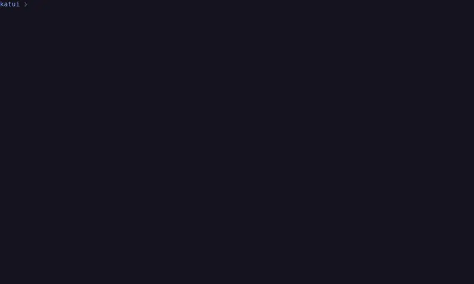

<h1 align="center">katui</h1>

<p align="center">
  Real pixels in your terminal, from Rust, Python and Node.js.
</p>

<p align="center">
  <a href="#install">Install</a> ·
  <a href="#a-first-program">First program</a> ·
  <a href="#what-you-can-build">What you can build</a> ·
  <a href="#terminals">Terminals</a> ·
  <a href="#demos">Demos</a> ·
  <a href="docs/README.md">Guides</a> ·
  <a href="https://matheusfillipe.github.io/katui/katui/">API docs</a>
</p>

<p align="center"></p>

katui is a terminal UI library for Rust, Python and Node.js that draws real pixels. Apps, games
and video show up as images through the [kitty graphics protocol][kitty],
and terminals without it get [sixel][sixel] images or quarter-block
characters instead.

You describe what to show. katui finds out what the terminal supports, lays
out and draws your view, sends only the parts that changed, and passes keys
and mouse clicks back to you.

[kitty]: https://sw.kovidgoyal.net/kitty/graphics-protocol/
[sixel]: https://en.wikipedia.org/wiki/Sixel

## Install

katui needs Rust 1.90 or newer and runs on macOS and Linux. Start a project
and add katui with the `app` feature, which brings in the app runner and
the widgets:

```
cargo new counter && cd counter
cargo add katui --git https://github.com/matheusfillipe/katui --features app
```

For Python 3.10 or newer, install the package from PyPI. The
[Python guide](docs/python.md) starts from there:

```
pip install katui
```

For Node.js 22.18 or newer, install the package from npm. The
[Node.js guide](docs/node.md) starts from there:

```
npm install katui
```

For Go, add the module; the [Go guide](docs/go.md) starts there. For C,
each release has an archive with the header and the libraries, and the
[C guide](docs/c.md) shows how to link it:

```
go get github.com/matheusfillipe/katui/bindings/go
```

## A first program

Put this in `src/main.rs`. It is a complete katui app: a label and a button
that counts its clicks.

```rust
use katui::app::{Control, UiApp, run};
use katui::ui::{Align, Element};
use katui::widgets::{label, panel, primary_button};

#[derive(Default)]
struct Counter(u32);

impl UiApp for Counter {
    type Message = ();

    fn view(&self) -> Element<()> {
        panel([
            label(format!("Clicked {} times", self.0)),
            primary_button("Add one", ()),
        ])
        .align(Align::Center)
    }

    fn update(&mut self, (): ()) -> Control {
        self.0 += 1;
        Control::Redraw
    }
}

fn main() -> Result<(), katui::rt::RtError> {
    run(Counter::default())
}
```

Run it with `cargo run`, click the button, and press <kbd>Ctrl</kbd>+<kbd>C</kbd> to quit.

<!-- media: screenshot of the counter, cropped to the terminal window -->

## What you can build

### Pixel UIs

`katui::app` runs an app made of a `view` and an `update`. `katui::widgets`
gives you buttons, text fields and text areas, lists, tables, trees, scroll
views, checkboxes, switches, radio buttons, sliders, tabs, menus, selects,
tooltips, dialogs, toasts and split panes, laid out with flexbox and drawn
with proportional fonts. Clicks, drags, the mouse wheel, typing and paste
reach your app as messages.


### Games

`katui::game::play` runs a game loop that moves the world 60 times a second,
however fast the terminal draws. You move things in `step` and paint them in
`render` onto a `Light`, a canvas where colors add up like light, with
glows, lines, polygons and text. Add the `game` feature to use it.

```rust
use katui::game::{Game, HeldKeys, Key, Light, P2, play};

struct Ball(f32);

impl Game for Ball {
    fn step(&mut self, keys: &HeldKeys, dt: f32) {
        let push =
            f32::from(i8::from(keys.is_held(Key::Right)) - i8::from(keys.is_held(Key::Left)));
        self.0 += push * 80.0 * dt;
    }

    fn render(&mut self, light: &mut Light) {
        light.dim(0.0);
        let middle = P2::new(self.0, light.height() as f32 / 2.0);
        light.glow(middle, 24.0, [2.0, 0.9, 0.4]);
    }
}

fn main() -> Result<(), katui::rt::RtError> {
    play(Ball(40.0))
}
```

Hold the arrow keys to move the ball.


### Video

`katui::rt::media::VideoStream` runs ffmpeg, or any program that writes raw
RGBA frames, and gives you the frame that is due now. On a slow terminal it
skips frames, so the picture keeps to real time. The video demo plays files
and stream URLs at 30 frames a second, with pause, seek and mute.



### HTML and markdown

`katui::content::html` turns an HTML and CSS subset into a view: block and
flex layout, styled text, colors, padding, borders, images and links.
`katui::content::markdown_view` does the same for markdown. Enable them
with the `html` feature.


### Images in ratatui apps

The `ratatui` feature adds `KatuiBackend`, a ratatui backend, and
`katui::ratatui::run::run`, which runs a ratatui app on katui's event loop.
Your existing widgets keep working, with real images placed next to them.


## Terminals

| Terminal | What katui draws |
|---|---|
| kitty, Ghostty, iTerm2 3.7 | Full pixels through the kitty graphics protocol |
| Terminals with sixel | Sixel images |
| Any other color terminal | Quarter blocks, four pixels per cell |
| tmux | Kitty graphics, when the terminal outside tmux speaks it |

katui checks what the terminal supports when it starts. To choose yourself,
set `KATUI_GRAPHICS` when you run your app:

```
KATUI_GRAPHICS=blocks cargo run
```

Inside tmux, katui ties every image to placeholder characters, so tmux
moves, hides and clears images along with the text of the pane. tmux needs
to pass graphics through to the outer terminal and to know it has true
color. The other lines let keys, focus changes and the mouse reach your app
without delay:

```
set -s escape-time 0
set -g allow-passthrough on
set -g focus-events on
set -g mouse on
set -as terminal-features ',xterm*:RGB,xterm*:sync'
```

To try the demos without touching your own sessions, save that as
`katui.conf` and start a separate tmux server with only that config:

```
tmux -L katui -f katui.conf new -s demos
```

## Demos

Clone the repository and run any of these with [just](https://github.com/casey/just):

| Command | What it shows |
|---|---|
| `just demo-counter` | The first program above |
| `just demo-glow` | The game example above |
| `just demo-todo` | A task list with tabs, a text field and a progress bar |
| `just demo-widgets` | Every widget in one app: menus, a tree, a table, a note, toasts and a dialog |
| `just demo-browse` | A page viewer for local HTML, with scrolling and links |
| `just demo-html` | Every part of the HTML and CSS subset on one page |
| `just demo-ratatui` | An image viewer made of ratatui widgets, with the picture beside them |
| `just demo-video` | A video player for a file or URL, or a test pattern with a beep when you give it none |
| `just demo-shardrift` | An asteroids-style game |
| `just demo-lumenshaft` | A falling-block game in a 3D shaft |
| `just demo-cube` | A lit cube in software 3D that the arrow keys spin |
| `just demo-plasma` | An interference plasma |

The same apps and a game written in Python run with `just py-demo`, like
`just py-demo widgets`. They live in
[bindings/python/examples](bindings/python/examples).

C and Go examples run with `just c-demo todo` and `just go-demo todo`, from
[bindings/c/examples](bindings/c/examples) and
[bindings/go/examples](bindings/go/examples).

The same apps and game in TypeScript run with `just node-demo`, like
`just node-demo widgets`. They live in
[bindings/node/examples](bindings/node/examples).

`just --list` shows the rest, and `just info` prints what katui detected in
your terminal. The video demo needs `ffmpeg` for the picture and `ffplay`
for the sound.

## Learn more

The [guides](docs/README.md) walk you through each kind of program, and the
[API docs](https://matheusfillipe.github.io/katui/katui/) list every type
and function.

## Status

katui is young. It works in the terminals above and in its own demos, the
API still changes between commits. Each release tag publishes the crates
to crates.io, the Python package to PyPI and the Node package to npm,
with the same version.

## Develop

Contributors follow the design rules in [ARCHITECTURE.md](ARCHITECTURE.md)
and the workflow in [AGENTS.md](AGENTS.md). The checks run through
[just](https://github.com/casey/just), and the Python checks need
[uv](https://docs.astral.sh/uv/). [Building, testing and
publishing](docs/publishing.md) explains each check and how a release
reaches PyPI:

```
just check   # lint, after every change
just ci      # every check, before every commit
just hooks   # install the git hooks, once per clone
```

## License

katui is licensed under either the [MIT license](LICENSE-MIT) or the
[Apache License 2.0](LICENSE-APACHE), at your option.
