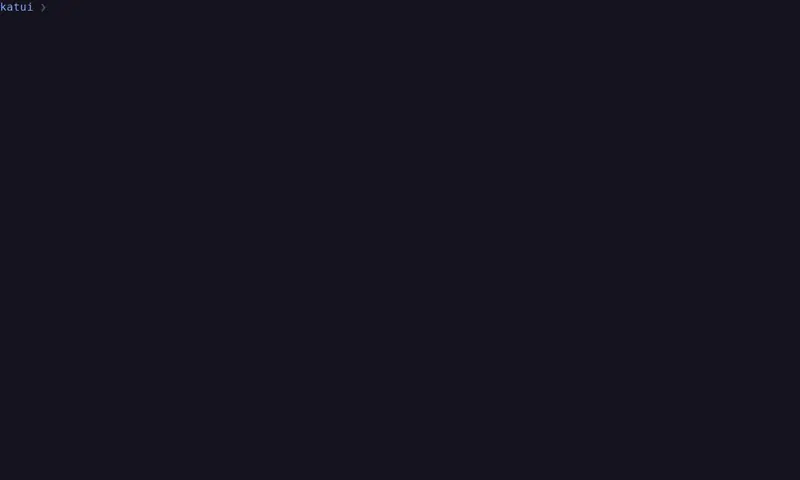

<h1 align="center">katui for Go</h1>

<p align="center">
  katui is a Go module for apps, games and documents drawn in pixels inside the terminal.
</p>

<p align="center">
  <a href="#install">Install</a> ·
  <a href="https://github.com/h4ks-com/katui/blob/main/docs/go.md">Guide</a> ·
  <a href="https://github.com/h4ks-com/katui/tree/main/bindings/go/examples">Examples</a> ·
  <a href="https://pkg.go.dev/github.com/h4ks-com/katui/bindings/go">API reference</a>
</p>

<p align="center"></p>

It sends pictures to the terminal through the kitty graphics protocol, and
through sixel or blocks of colored cells where that is missing. Only what
changed between frames is sent. The engine is the
[katui](https://github.com/h4ks-com/katui) Rust library, shipped
inside the module as a prebuilt static library, so you need no Rust to use
it.

```go
package main

import (
	"fmt"
	"log"

	katui "github.com/h4ks-com/katui/bindings/go"
)

type counter struct{ count int }

func (c *counter) View() *katui.Element {
	return katui.Panel(
		katui.Label(fmt.Sprintf("Clicked %d times", c.count)),
		katui.PrimaryButton("Add one", func() { c.count++ }),
	)
}

func (c *counter) Update(message any) katui.Control { return katui.Redraw }

func main() {
	if err := katui.Run(&counter{}); err != nil {
		log.Fatal(err)
	}
}
```

## Install

katui runs on Linux and macOS, on x86_64 and arm64, with Go 1.24 or newer
and a C compiler for cgo. Add it to your module:

```sh
go get github.com/h4ks-com/katui/bindings/go
```

Save the example above as `main.go` and run it with `go run .`. A panel
shows a line of text and a button. Click the button with the mouse and the
count goes up. Press <kbd>Ctrl</kbd>+<kbd>C</kbd> to quit.

kitty, Ghostty and iTerm2 3.7 show the app at full resolution, and
terminals with sixel graphics, like foot, show it as sixel. Other
terminals, like macOS Terminal and GNOME Terminal, show the same app in
colored block characters at a lower resolution.

## Features

- **Widgets:** labels, buttons, text fields and areas, lists, tables, trees,
  tabs, switches, sliders, selects, menus, tooltips, dialogs, toasts, scroll
  views and split panes, in a dark or light theme or your own.
- **Messages:** a click sends any Go value to `Update`, or runs a `func()`
  you hand the widget.
- **Documents:** `katui.HTML` and `katui.Markdown` turn a page into
  elements, with links that send messages and images you supply.
- **Games:** `katui.Play` calls your game 60 times a second to move and
  then draw it, with shapes, glowing light, text and particles.
- **Tests:** `katui.NewScreen` draws an app into an image and sends it
  clicks and keys without a terminal, and `katui.Frame` does the same for
  games.

## A game

```go
package main

import (
	"log"

	katui "github.com/h4ks-com/katui/bindings/go"
)

type comet struct{ x float32 }

func (c *comet) Step(keys *katui.Keys, dt float32) {
	if keys.IsHeld("right") {
		c.x += 60 * dt
	}
	if keys.IsHeld("left") {
		c.x -= 60 * dt
	}
}

func (c *comet) Render(light *katui.Light) {
	light.Dim(0.8)
	light.Glow(katui.Point{X: c.x, Y: 30}, 6, katui.SRGB(255, 140, 60))
}

func main() {
	if err := katui.Play(&comet{x: 40}); err != nil {
		log.Fatal(err)
	}
}
```

The left and right arrow keys steer the comet. <kbd>Q</kbd> or
<kbd>Ctrl</kbd>+<kbd>C</kbd> quits.

The [examples](https://github.com/h4ks-com/katui/tree/main/bindings/go/examples)
include a counter, a to-do list, a Markdown help screen and this comet with
sparks.

## Status

katui is young, and its API can still change between minor versions. The
Go module has the same version as the Rust crates and is released together
with them. Windows is not supported.

## License

katui is licensed under either of the
[Apache License 2.0](https://github.com/h4ks-com/katui/blob/main/LICENSE-APACHE)
or the [MIT license](https://github.com/h4ks-com/katui/blob/main/LICENSE-MIT),
at your option.
