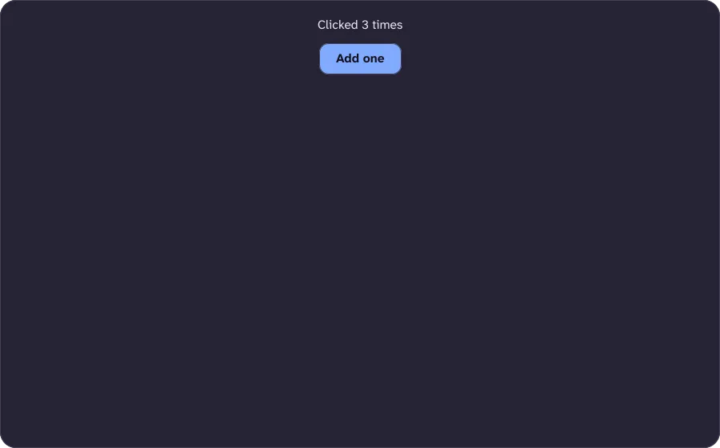
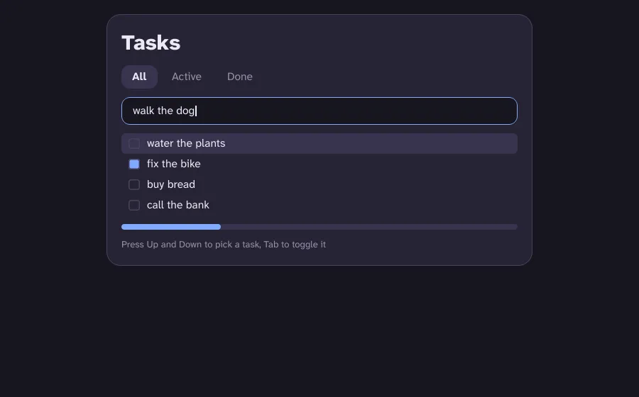
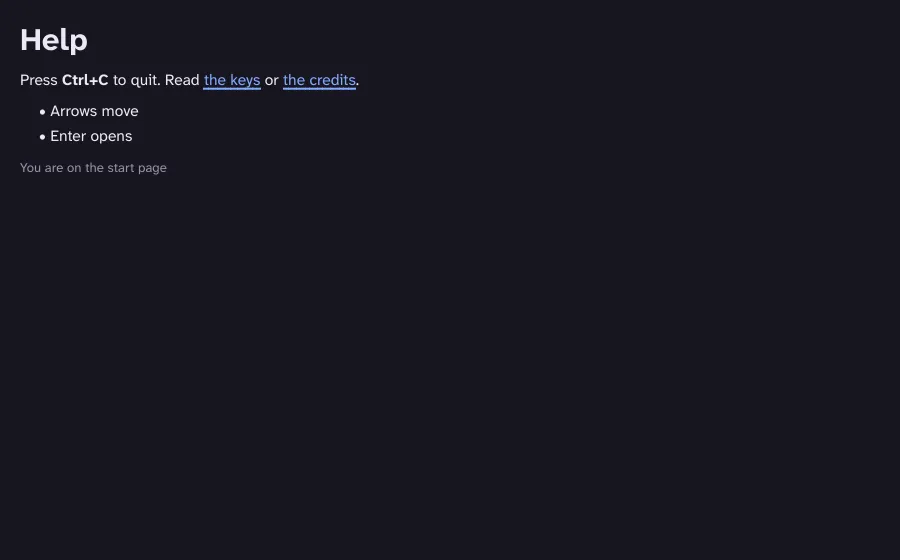
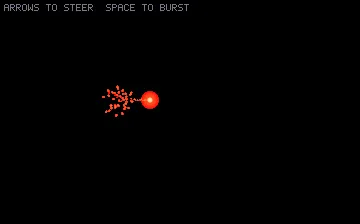

# Go examples

This folder holds small katui programs written in Go, one per folder, from a click counter to a game.

Run one from the repository root with `just go-demo <name>`, like `just go-demo todo`. It needs Go, a C compiler and a Rust toolchain, since it builds the static library first. Press <kbd>Ctrl</kbd>+<kbd>C</kbd> to quit any of them.

The [Go guide](../../../docs/go.md) explains the API they use.

### counter

The smallest katui program: a label and a button. Click **Add one** to count up.

### todo

A task list with filter tabs, a text field, checkboxes and a progress bar. Type a task and press <kbd>Enter</kbd> to add it, use <kbd>Up</kbd> and <kbd>Down</kbd> to pick one and <kbd>Tab</kbd> to tick it, and click the tabs to filter.

### help

A help screen written in Markdown. Click a link to switch pages.

### comet

A game: a glowing comet that trails sparks. Steer it with the arrow keys and press <kbd>Space</kbd> to burst.

