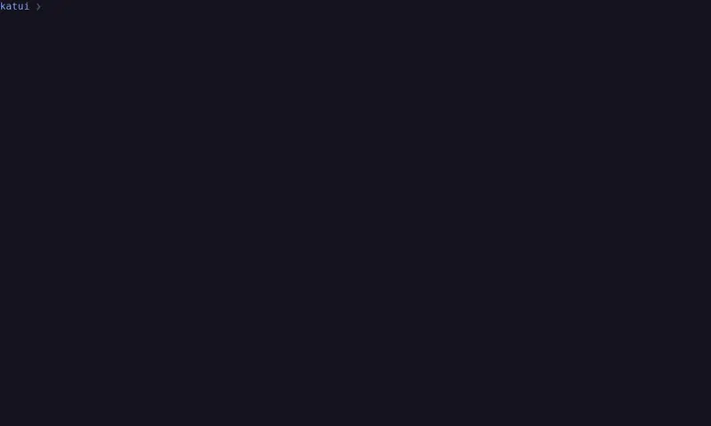

<h1 align="center">katui for Node.js</h1>

<p align="center">
  katui is a Node.js library for apps, games and documents drawn in pixels inside the terminal.
</p>

<p align="center">
  <a href="#install">Install</a> ·
  <a href="https://github.com/h4ks-com/katui/blob/main/docs/node.md">Guide</a> ·
  <a href="https://github.com/h4ks-com/katui/tree/main/bindings/node/examples">Examples</a> ·
  <a href="https://h4ks-com.github.io/katui/katui/">API reference</a>
</p>

<p align="center"></p>

It sends pictures to the terminal through the kitty graphics protocol, and
through sixel or blocks of colored cells where that is missing. Only what
changed between frames is sent. The engine is the
[katui](https://github.com/h4ks-com/katui) Rust library, shipped as a
prebuilt native module, so you need no Rust to use it. The package comes
with its TypeScript types.

```ts
import { App, label, panel, primaryButton, run } from '@mattfillipe/katui'

class Counter extends App {
  count = 0

  view() {
    return panel(
      label(`Clicked ${this.count} times`),
      primaryButton('Add one', () => {
        this.count += 1
      }),
    )
  }
}

run(new Counter())
```

## Install

katui runs on Linux and macOS with Node.js 22.18 or newer. Install it into
your project:

```sh
npm install @mattfillipe/katui
```

Save the example above as `counter.ts` and run it with `node counter.ts`.
A panel shows a line of text and a button. Click the button with the mouse
and the count goes up. Press <kbd>Ctrl</kbd>+<kbd>C</kbd> to quit.

kitty, Ghostty and iTerm2 3.7 show the app at full resolution, and
terminals with sixel graphics, like foot, show it as sixel.
Other terminals, like macOS Terminal and GNOME Terminal, show the same app
in colored block characters at a lower resolution.

## Features

- **Widgets:** labels, buttons, text fields and areas, lists, tables, trees,
  tabs, switches, sliders, selects, menus, tooltips, dialogs, toasts, scroll
  views and split panes, in a dark or light theme or your own.
- **Layout:** rows, columns and stacks laid out with flexbox, sized in pixels
  or in terminal cells so they follow the font size.
- **Documents:** `html` and `markdown` turn a page into elements, with links
  that send messages and images you supply.
- **Games:** `play` calls your game 60 times a second to move and then draw
  it, with shapes, glowing light, text and particles.
- **Tests:** `Screen` draws an app into an image and sends it clicks and
  keys without a terminal, and `frame` does the same for games.

## A game

```ts
import { Game, type Keys, type Light, play, srgb } from '@mattfillipe/katui'

class Comet extends Game {
  x = 40

  step(keys: Keys, dt: number) {
    this.x += 60 * dt * (Number(keys.isHeld('right')) - Number(keys.isHeld('left')))
  }

  render(light: Light) {
    light.dim(0.8)
    light.glow([this.x, 30], 6, srgb(255, 140, 60))
  }
}

play(new Comet())
```

The left and right arrow keys steer the comet. <kbd>Q</kbd>,
<kbd>Esc</kbd> or <kbd>Ctrl</kbd>+<kbd>C</kbd> quits.

`run` and `play` keep the thread busy until the app or game ends, so
timers and promises wait until then. The
[examples](https://github.com/h4ks-com/katui/tree/main/bindings/node/examples)
include a to-do list, the full widget tour, a Markdown help screen, an HTML
browser and this comet with sparks.

## Status

katui is young, and its API can still change between minor versions. The
npm package has the same version as the Rust crates and is released
together with them. Windows is not supported.

## License

katui is licensed under either of the
[Apache License 2.0](https://github.com/h4ks-com/katui/blob/main/LICENSE-APACHE)
or the [MIT license](https://github.com/h4ks-com/katui/blob/main/LICENSE-MIT),
at your option.
