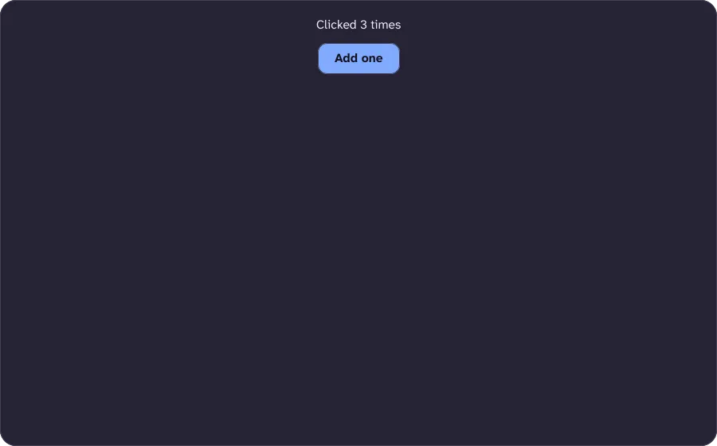
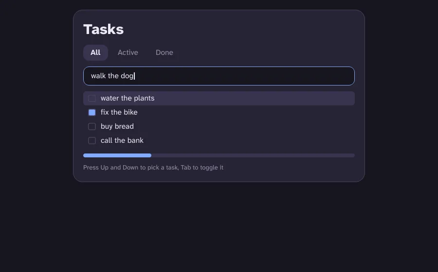
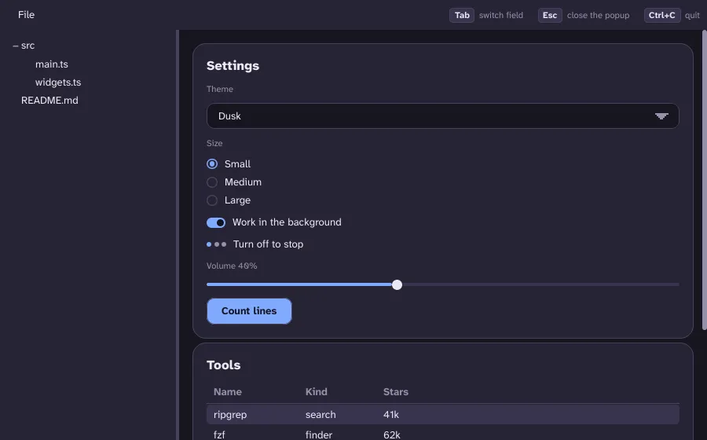
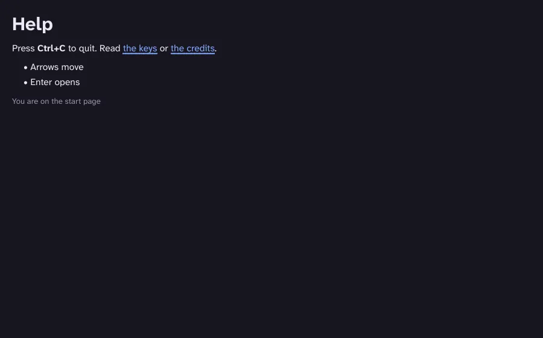
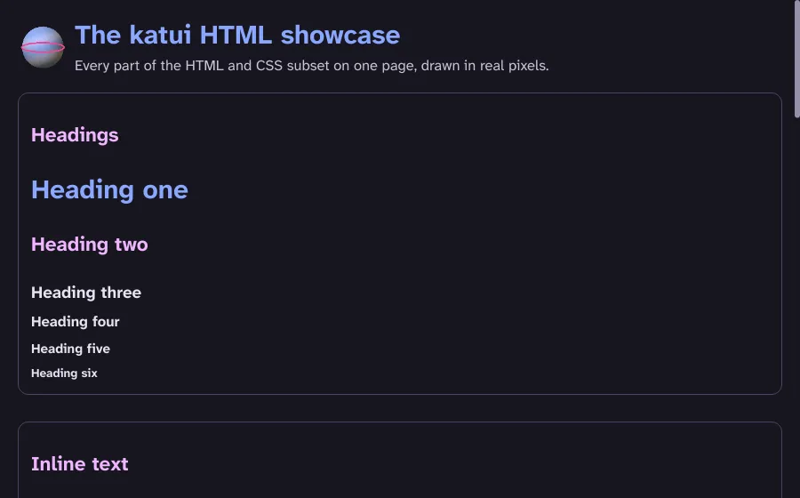
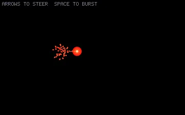

# Node examples

This folder holds small katui programs written in TypeScript, from a click counter to a game.

Run one from the repository root with `just node-demo <name>`, like `just node-demo todo`. It needs Node 22.18 or newer and a Rust toolchain, since it builds the native module first. Press <kbd>Ctrl</kbd>+<kbd>C</kbd> to quit any of them.

The [Node guide](../../../docs/node.md) explains the API they use.

### counter

The smallest katui program: a label and a button. Click **Add one** to count up.

### todo

A task list with filter tabs, a text field, checkboxes and a progress bar. Type a task and press <kbd>Enter</kbd> to add it, use <kbd>Up</kbd> and <kbd>Down</kbd> to pick one and <kbd>Tab</kbd> to tick it, and click the tabs to filter.

### widgets

A tour of the widget set: a menu bar, a file tree, a resizable split, settings controls, a table, a note, toasts and a quit dialog. The theme and size switch at runtime. Press <kbd>Tab</kbd> to move between the note and the table and <kbd>Esc</kbd> to close a popup, and use the mouse for the rest.

### help

A help screen written in Markdown. Click a link to switch pages.

### browse

A small browser for local HTML pages, opening the HTML and CSS showcase by default. Click links to follow them, scroll with the wheel or the arrow keys, and press <kbd>Backspace</kbd> to go back. Pass the path of another page after the name to open it.

### comet

A game: a glowing comet that trails sparks. Steer it with the arrow keys and press <kbd>Space</kbd> to burst.

