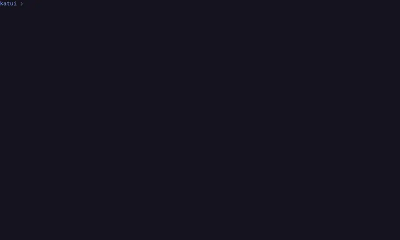

<h1 align="center">katui for Python</h1>

<p align="center">
  katui is a Python library for apps, games and documents drawn in pixels inside the terminal.
</p>

<p align="center">
  <a href="#install">Install</a> ·
  <a href="https://github.com/h4ks-com/katui/blob/main/docs/python.md">Guide</a> ·
  <a href="https://github.com/h4ks-com/katui/tree/main/bindings/python/examples">Examples</a> ·
  <a href="https://h4ks-com.github.io/katui/katui/">API reference</a>
</p>

<p align="center"></p>

It sends pictures to the terminal through the kitty graphics protocol, and
through sixel or blocks of colored cells where that is missing. Only what
changed between frames is sent. The engine is the
[katui](https://github.com/h4ks-com/katui) Rust library, shipped
inside prebuilt wheels, so you need no Rust to use it.

```python
import katui
from katui.widgets import label, panel, primary_button


class Counter(katui.App[katui.Action]):
    def __init__(self) -> None:
        self.count = 0

    def view(self) -> katui.Element[katui.Action]:
        return panel(label(f"Clicked {self.count} times"), primary_button("Add one", self.add))

    def add(self) -> None:
        self.count += 1


katui.run(Counter())
```

## Install

katui runs on Linux and macOS with Python 3.14 or newer. Install it into a
virtual environment:

```sh
python3 -m venv .venv && . .venv/bin/activate && pip install katui
```

Save the example above as `counter.py` and run it with `python counter.py`.
A panel shows a line of text and a button. Click the button with the mouse
and the count goes up. Press <kbd>Ctrl</kbd>+<kbd>C</kbd> to quit.

kitty, Ghostty and iTerm2 3.7 show the app at full resolution, and
terminals with sixel graphics, like foot, show it as sixel.
Other terminals, like macOS Terminal and GNOME Terminal, show the same app
in colored block characters at a lower resolution.

## Features

- **Widgets:** labels, buttons, text fields and areas, lists, tables, trees,
  tabs, switches, sliders, selects, menus, tooltips, dialogs, toasts, scroll
  views and split panes, in a dark or light theme or your own.
- **Layout:** rows, columns and stacks laid out with flexbox, sized in pixels
  or in terminal cells so they follow the font size.
- **Documents:** `katui.html` and `katui.markdown` turn a page into elements,
  with links that send messages and images you supply.
- **Games:** `katui.game` calls your game 60 times a second to move and
  then draw it, with shapes, glowing light, text and particles.
- **Tests:** `katui.testing.Screen` draws an app into an image and sends it
  clicks and keys without a terminal, and `frame` does the same for games.

## A game

```python
from katui import game
from katui.game import Keys, Light, srgb


class Comet(game.Game):
    def __init__(self) -> None:
        self.x = 40.0

    def step(self, keys: Keys, dt: float) -> None:
        self.x += 60 * dt * (keys.is_held("right") - keys.is_held("left"))

    def render(self, light: Light) -> None:
        light.dim(0.8)
        light.glow((self.x, 30), 6, srgb(255, 140, 60))


game.play(Comet())
```

The left and right arrow keys steer the comet. <kbd>Q</kbd> or
<kbd>Ctrl</kbd>+<kbd>C</kbd> quits.

The [examples](https://github.com/h4ks-com/katui/tree/main/bindings/python/examples)
include a to-do list, the full widget tour, a Markdown help screen, an HTML
browser and this comet with sparks.

## Status

katui is young, and its API can still change between minor versions. The
Python package has the same version as the Rust crates and is released
together with them. Windows is not supported.

## License

katui is licensed under either of the
[Apache License 2.0](https://github.com/h4ks-com/katui/blob/main/LICENSE-APACHE)
or the [MIT license](https://github.com/h4ks-com/katui/blob/main/LICENSE-MIT),
at your option.
