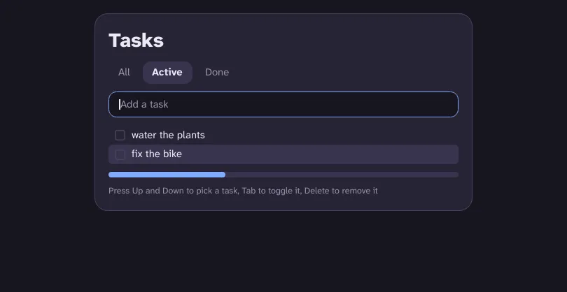
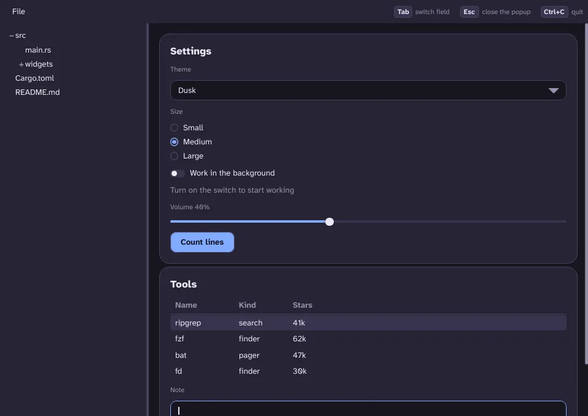
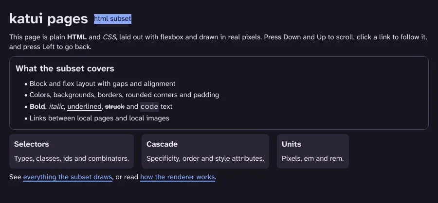
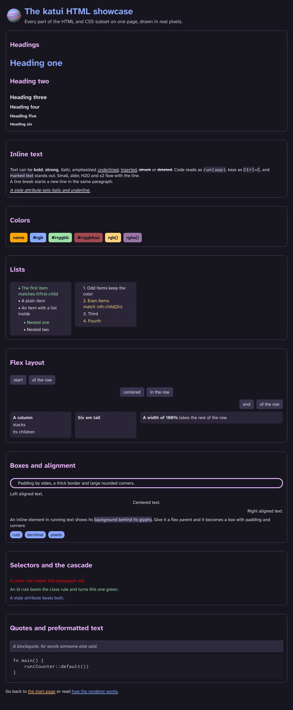

# katui-app examples

These are UI apps built on katui-app, the event loop that runs a widget view in the terminal.

### todo

A task list with tabs, a text field, checkboxes and a progress bar.

Run it with `just demo-todo`. Type a task and press Enter to add it, press Up and Down to pick a task, Tab to toggle it and Delete to remove it. Press Ctrl+C to quit.

### widgets

A tour of every widget in one app: a menu bar, a file tree beside a scrolling page of controls, a table, a note, toasts and a dialog. The theme and size settings restyle the whole app.

Run it with `just demo-widgets`. Use the mouse or Tab to move between fields, press Esc to close a popup and Ctrl+C to quit.

### browse

A page viewer for local HTML files, drawn through katui's HTML and CSS subset. The pages in `pages/` link to each other.

Run it with `just demo-browse` for the bundled pages, or `just demo-browse path/to/page.html` for your own. Press Down and Up or j and k to scroll, Space to scroll a screen, click a link to follow it, Left or Backspace to go back, and q to quit.

### showcase

The same viewer on `pages/showcase.html`, a page that uses every part of the HTML and CSS subset: headings, inline styles, colors, lists, flex layout, borders, selectors and preformatted text.

Run it with `just demo-html`. The keys are the same as in browse.

