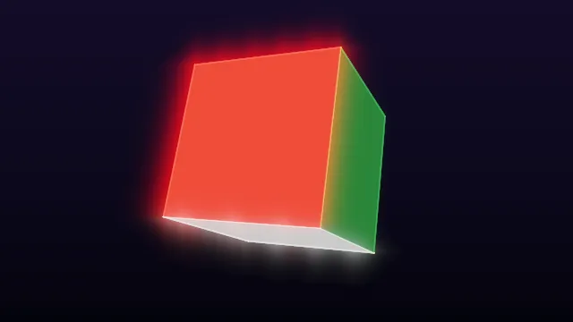
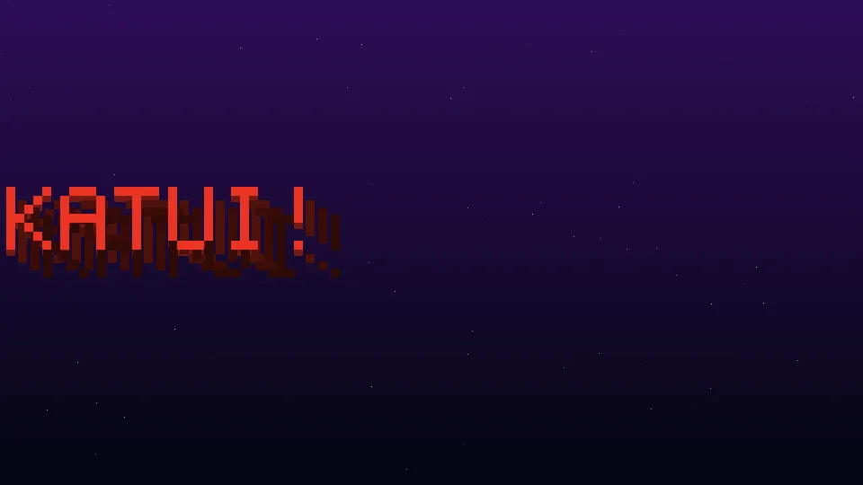
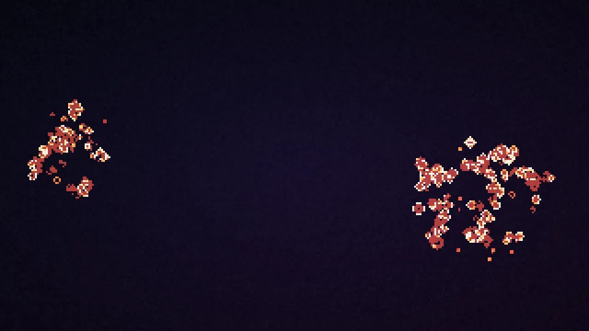
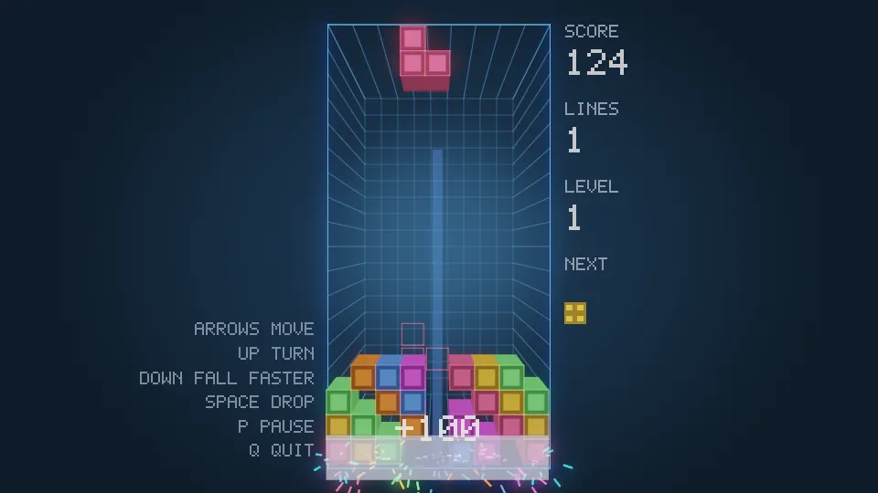
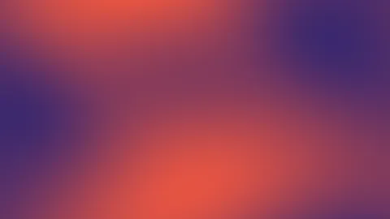
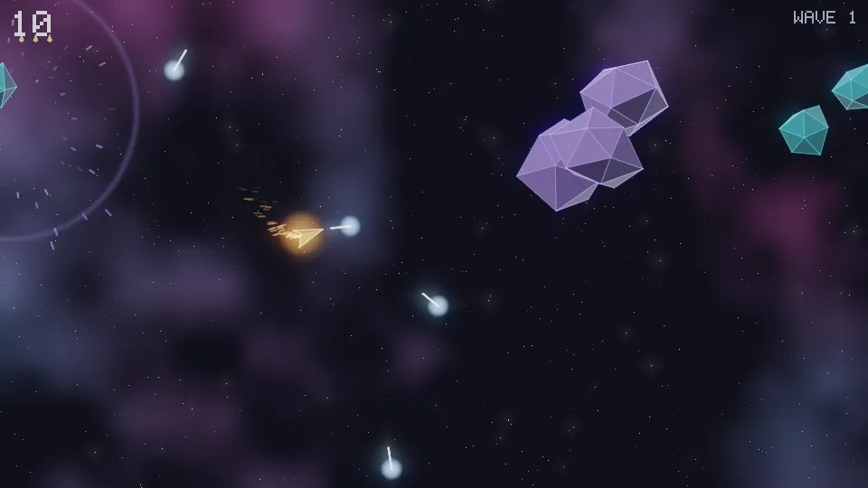
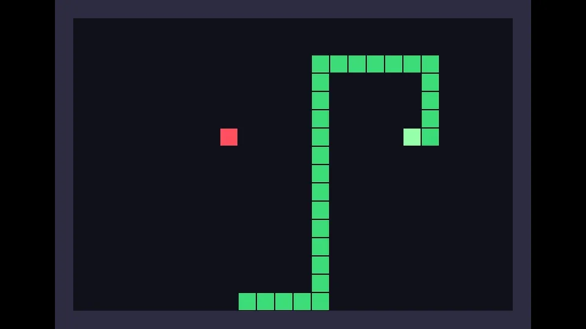
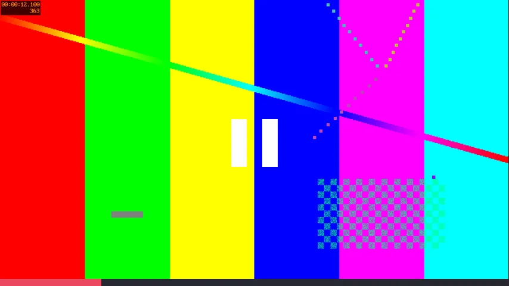

# katui-game examples

These are games and animations built on katui-game, which steps a game at a fixed rate and draws its light buffer as real pixels. The `support/` folder holds a helper the tests share.

Every demo here quits with q, Esc or Ctrl+C.

### cube

A lit cube spinning in software 3D, with a glow around its edges.

Run it with `just demo-cube`. Hold the arrow keys to steer its spin.

### dvd

The bouncing logo over a twinkling starfield. It changes color and speeds up each time it hits a corner.

Run it with `just demo-dvd`.

### life

Conway's game of life with cells that glow by age and leave fading ash. A board that stalls seeds itself again.

Run it with `just demo-life`.

### lumenshaft

A falling-block game in a 3D shaft, with pieces of three to five cells and sparks when a row clears.

Run it with `just demo-lumenshaft`. Press Enter to start, Left and Right to move, Up to turn, hold Down to fall faster, Space to drop and p to pause.

### plasma

An interference plasma that cycles from deep blue through orange to pink.

Run it with `just demo-plasma`.

### shardrift

An asteroids-style game: fly a ship through a nebula and shoot crystal rocks into smaller shards.

Run it with `just demo-shardrift`. Press Enter to start, Left and Right or a and d to turn, Up and Down or w and s to fly, Space or f to fire and p to pause.

### snake

A snake that plays itself on a bordered grid.

Run it with `just demo-snake`.

### video

A video player that decodes a file or stream URL with ffmpeg and plays its sound with ffplay. Without an argument it plays ffmpeg's beeping test pattern, so it needs ffmpeg installed either way.

Run it with `just demo-video`, or `just demo-video clip.mp4` for a file. Press Space to pause, Left and Right to seek five seconds and m to mute.

