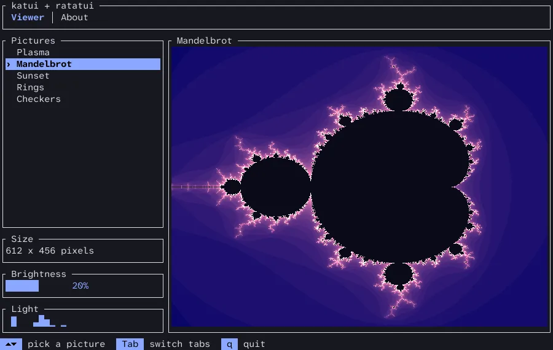

# katui-ratatui examples

This is a ratatui app running on katui-ratatui, the ratatui backend that also draws images through the kitty graphics protocol.

### viewer

An image viewer made of ratatui's own widgets: a list, tabs, a gauge and a sparkline, with the picture drawn beside them in real pixels. It shows five generated pictures and any image files you pass.

Run it with `just demo-ratatui`, or `just demo-ratatui photo.jpg` to add your own files. Press Up and Down or j and k to pick a picture, Tab to switch tabs and q to quit.

