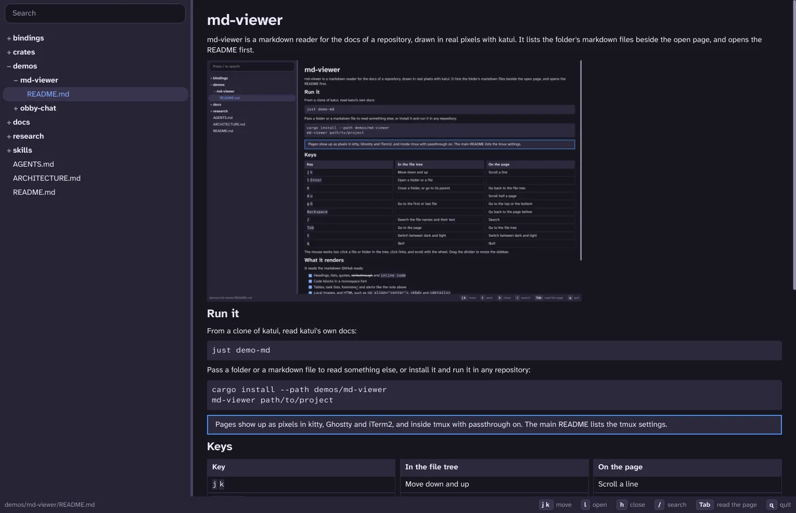

# md-viewer

md-viewer is a markdown reader for the docs of a repository, drawn in real pixels with katui. It lists the folder's markdown files beside the open page, and opens the README first.



## Run it

From a clone of katui, read katui's own docs:

```sh
just demo-md
```

Pass a folder or a markdown file to read something else, or install it and run it in any repository:

```sh
cargo install --path demos/md-viewer
md-viewer path/to/project
```

> [!NOTE]
> Pages show up as pixels in kitty, Ghostty and iTerm2, and inside tmux with passthrough on. The main README lists the tmux settings.

## Keys

| Key | In the file tree | On the page |
|---|---|---|
| `j` `k` | Move down and up | Scroll a line |
| `l` `Enter` | Open a folder or a file | |
| `h` | Close a folder, or go to its parent | Go back to the file tree |
| `d` `u` | | Scroll half a page |
| `g` `G` | Go to the first or last file | Go to the top or the bottom |
| `Backspace` | | Go back to the page before |
| `/` | Search the file names and their text | Search |
| `Tab` | Go to the page | Go to the file tree |
| `t` | Switch between dark and light | Switch between dark and light |
| `q` | Quit | Quit |

The mouse works too: click a file or folder in the tree, click links, and scroll with the wheel. Drag the divider to resize the sidebar.

## What it renders

It reads the markdown GitHub reads:

- [x] Headings, lists, quotes, ~~strikethrough~~ and `inline code`
- [x] Code blocks in a monospace font
- [x] Tables, task lists, footnotes[^1] and alerts like the note above
- [x] Local images, SVG drawings and animated GIF and WebP files
- [x] Videos in `<video>` tags, played without sound when `ffmpeg` is installed
- [x] HTML such as `<p align="center">`, `<kbd>` and `<details>`
- [ ] Syntax colors in code blocks
- [ ] Remote images and SVG badges

Links to headings scroll the page there, links to other markdown files open in the viewer, and other links open in the program your system picks for them.

[^1]: Footnotes show at the end of the page.
