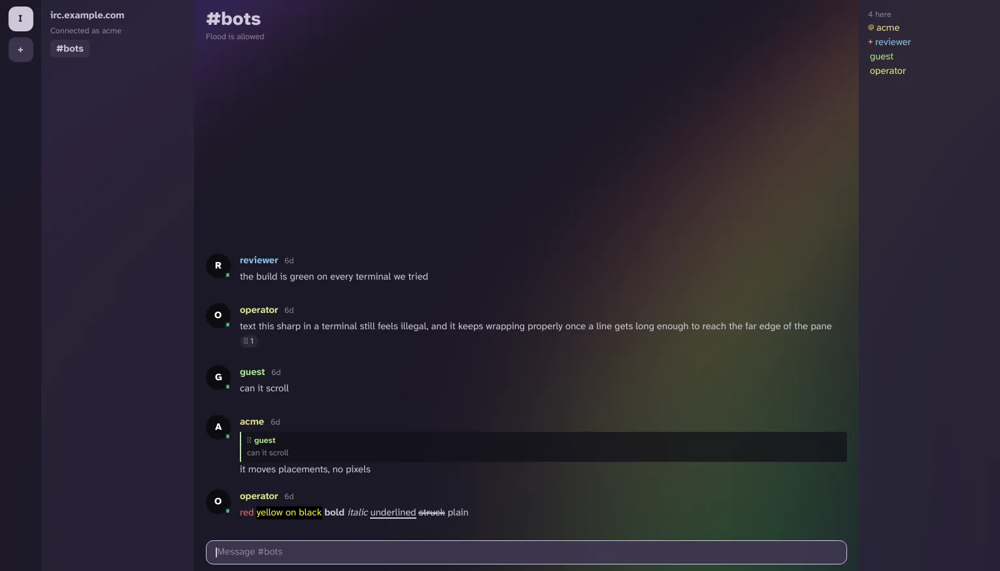

# obby-chat

An IRC client built on the full katui engine. It has its own Cargo workspace and is licensed under the GPL.

### obby-chat

A chat client with servers, channels, a member list, replies, reactions, IRC colors and an animated backdrop behind the conversation. It keeps everything in memory.

Run it with `just demo-irc`, fill in the server, nick and channel in the form and connect. Type a message and press Enter to send it, start with `/` for commands and press Tab to complete one. Press Up and Down or Page Up and Page Down to scroll, Esc to cancel a reply and Ctrl+Q or Ctrl+C to quit.

