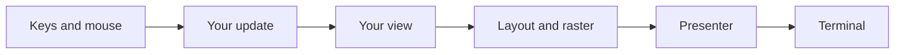

# How katui works

This page explains what happens between your `view` and the pixels on
screen, and which crate does each part. You don't need any of it to write
an app, but it helps when you want to know why something looks or performs
the way it does.

## One frame

1. **Input.** The runtime reads bytes from the terminal and parses them
   into keys, mouse events, pastes and focus changes. A click becomes the
   message of the element under the pointer.
2. **Update and view.** Your app changes its state and builds a new
   element tree.
3. **Layout and raster.** katui lays the tree out with flexbox, then draws
   each part into its own layer of pixels, with text shaped from real
   fonts. A layer is drawn again only when its content changed, so
   scrolling a list moves layers without drawing them again.
4. **Present.** A presenter turns the layers into terminal bytes. With
   kitty graphics, each layer becomes an image that is sent once and then
   only moved; a full-screen picture is cut into tiles, and only the tiles
   that changed are sent. With sixel, changed tiles go out as sixel images,
   and with blocks, changed cells are redrawn with quarter-block
   characters.
5. **Terminal.** The bytes are wrapped in synchronized output, so the
   terminal never shows a half-drawn frame.

## Finding out what the terminal can do

When an app starts, katui sends one batch of questions to the terminal: does
it understand kitty graphics, can it store animation frames, what is it
called, how big is a cell in pixels, and does it support sixel. The batch
ends with a question every terminal answers, so katui knows when the
answers are complete, and it waits less than a second for a terminal that
stays silent.

The result picks the backend: kitty graphics first, then sixel, then quarter
blocks. You can override it with `KATUI_GRAPHICS`.

## Inside tmux

tmux sits between your app and the terminal, and it does not know about
images. katui wraps its image commands so tmux passes them through, and
anchors every image to Unicode placeholder characters. tmux treats those
as ordinary text, so when you switch windows, split panes or scroll, tmux
moves and hides the image along with the rest of the pane.

tmux also drops output it cannot forward fast enough, so katui paces itself
there: it waits for the terminal to confirm a batch before sending the next.

## The crates

Each crate depends only on crates below it in this table. Only `katui-rt`
reads from or writes to the terminal; the other core crates work on plain
data, which is why most of katui is tested without a terminal.

| Crate | What it does |
|---|---|
| `katui` | Re-exports everything below under one name, with features |
| `katui-app` | `run(app)`: the runner for pixel UI apps |
| `katui-game` | `play(game)`: the fixed-step game runner and the light canvas |
| `katui-ratatui` | The ratatui backend and image helpers |
| `katui-content` | Markdown, and the HTML and CSS subset |
| `katui-widgets` | The theme, widgets and their state |
| `katui-ui` | Element trees, flexbox layout and hit testing |
| `katui-layout` | Splitting cell rectangles by constraints |
| `katui-draw` | Text shaping, shapes and pixel blending |
| `katui-rt` | The terminal: raw mode, the event loop, probing, video streams |
| `katui-present` | Presenters that turn scenes into terminal bytes |
| `katui-scene` | Cells, pixel surfaces, placements and what changed |
| `katui-proto` | The kitty, sixel and input protocols, and capability parsing |

## Testing

Because the core does no I/O, tests run on bytes and pixels:

- Encoders are checked against exact expected bytes.
- Parsers are fed random input and must never panic.
- The capability probe is checked against answers recorded from real
  terminals.
- UI and HTML tests render to PNG files under `target/`, so you can open
  them and look.

Run `just ci` to run all of it.
